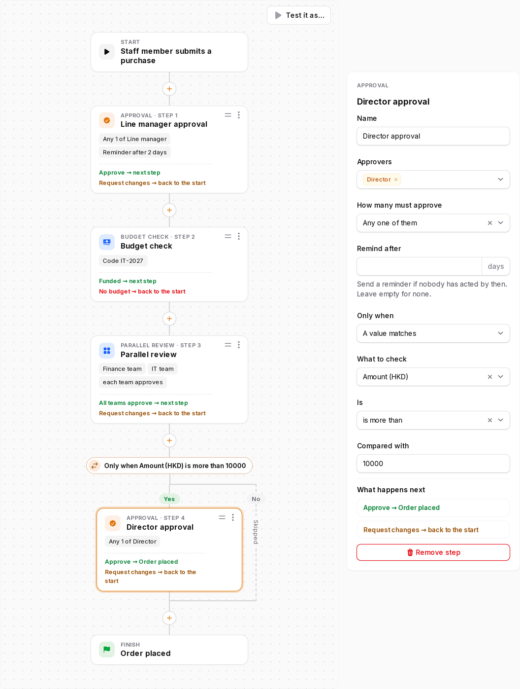
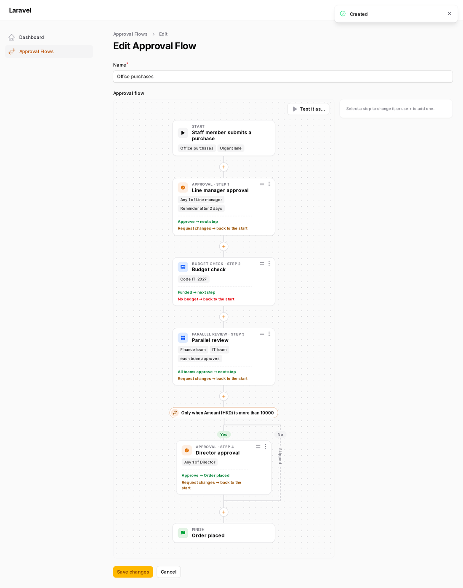
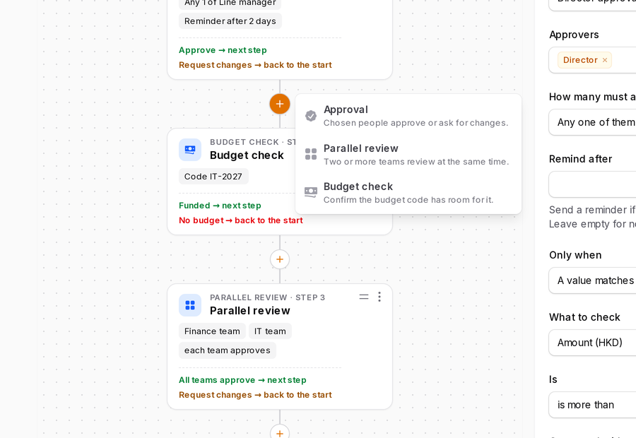
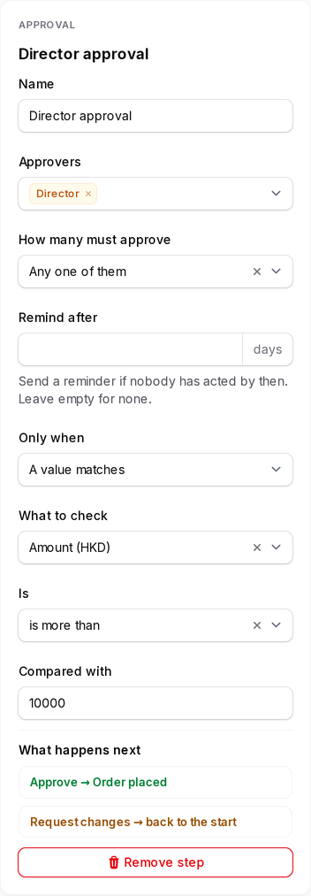
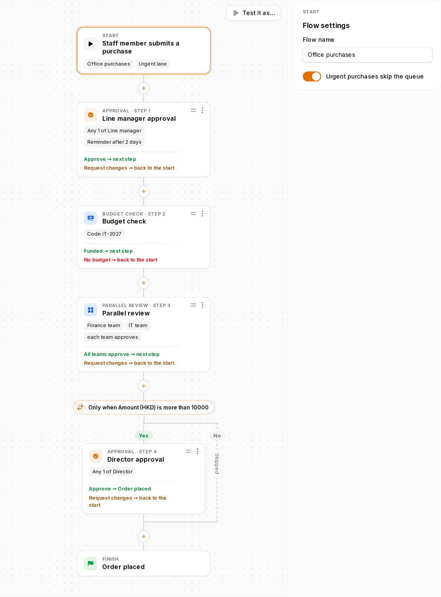
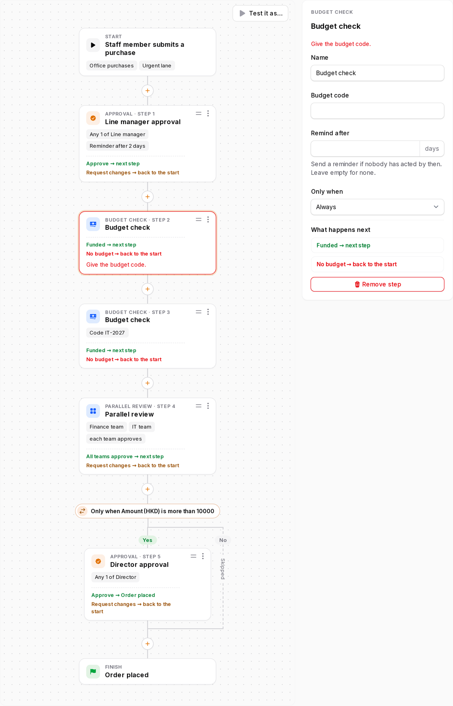
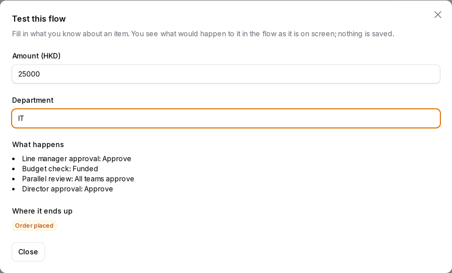
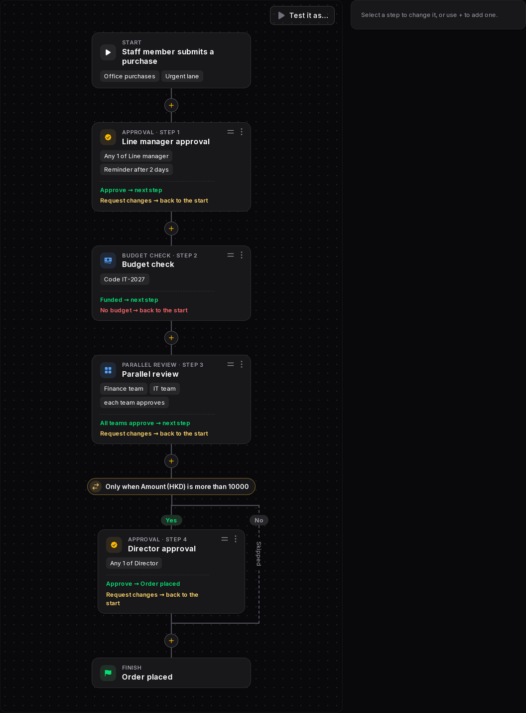
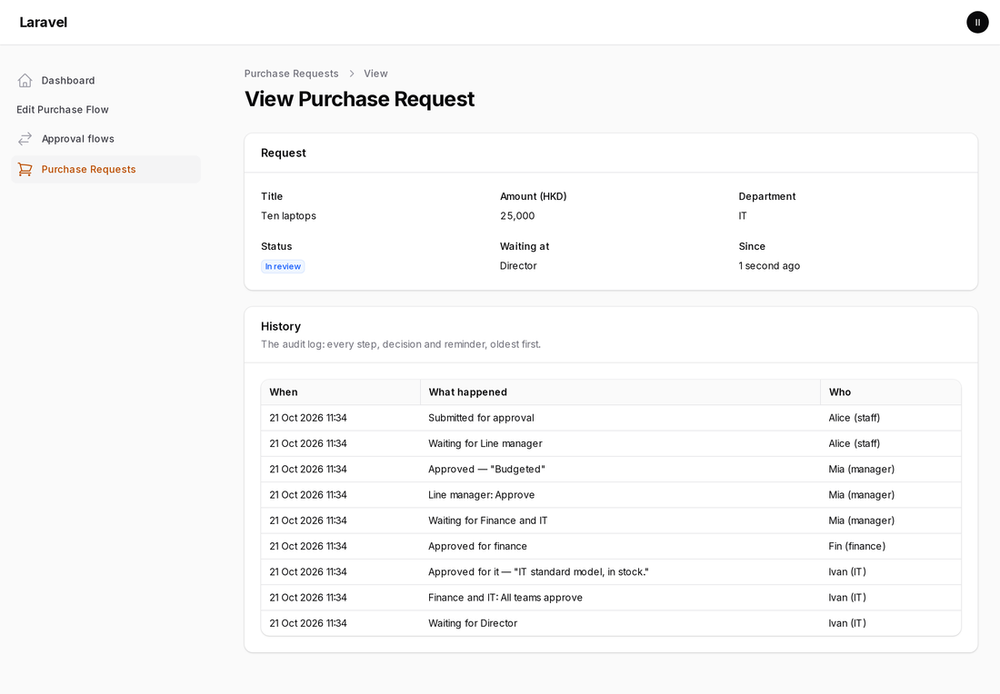

# Filament Flow Builder

A visual, card-based **workflow builder for Filament v5**: approval chains, review steps, sign-offs, any process that moves an item through steps.

**You** define in PHP which steps and conditions a flow may use. **Your users** then design their own flows in the panel: add steps with "+", drag them into order, add conditions, set reminders, and try a flow out before saving it. A small runner then moves real items through a saved flow and fires events. Notifications, tasks and side effects stay in your app.



It is a standalone Filament plugin. It needs no other Banyan package and has no database tables of its own: a flow is plain data that you store in a JSON column. It was extracted from [Banyan CMS](https://github.com/BanyanCMS/banyan), whose *Settings → Workflows* runs on it. Licensed **MIT**.

> **Building a real process?** Read the **[usage guide](docs/guide.md)**. It walks through a complete, tested example (purchase requests): matching approvers to your users, status, Approve and Request changes, "any / all / a number / every team" rules, what happens when something fails midway, the audit log, notifications and reminders.

> **Where to change it:** the source lives in the Banyan monorepo at `packages/filament-flow-builder`. This repository is its published split. Open issues and pull requests against the [monorepo](https://github.com/BanyanCMS/banyan).

---

## Contents

- [What you get](#what-you-get)
- [Requirements](#requirements)
- [Install](#install)
- [Quick start: an approval flow in five files](#quick-start-an-approval-flow-in-five-files)
- [The editor, screen by screen](#the-editor-screen-by-screen)
- [Defining a flow](#defining-a-flow)
- [Step types](#step-types)
- [Conditions](#conditions)
- [Running a flow (the API)](#running-a-flow-the-api)
- [Two ways to put the builder on a page](#two-ways-to-put-the-builder-on-a-page)
- [A real example: purchase requests](#a-real-example-purchase-requests)
- [The stored data](#the-stored-data)
- [Look and feel, dark mode, languages](#look-and-feel-dark-mode-languages)
- [Reference](#reference)
- [Developing the plugin](#developing-the-plugin)

---

## What you get

| | |
|---|---|
| **Canvas** | Start and Finish cards, a "+" between every pair of steps, drag-and-drop or Move up/down to reorder, and a summary on each card (who, how many, reminder, outcomes). |
| **Settings panel** | The selected step's settings: any Filament fields you declare. |
| **Step types in code** | Built in: *Approval* (approvers, any or all or a number, reminder) and *Parallel review* (several teams at once). Add your own by extending one class. |
| **Presets** | One step type can offer several entries under "+", for example one ready-made step per department. |
| **Conditions** | "Only when …" on any step, drawn as a Yes/No branch. The built-in *A value matches* compares a value you provide with what the designer typed. Add your own. |
| **Flow settings** | Settings of the whole flow, on the Start card. |
| **Validation** | A step's problems ("Choose at least one approver.") show in red on its card, and the field will not save a flow that has any. |
| **Test it as…** | Fill in an example item and see which steps it passes, which it skips and where it ends, without saving. |
| **Runner** | `start()` and `decide()` move an item through a saved flow and fire `StepReached`, `StepSkipped`, `OutcomeChosen`, `FlowReturned` and `FlowFinished`. |
| **Theming** | It uses the panel's own colours, so it follows your theme and dark mode. |
| **Languages** | English, Traditional Chinese and Simplified Chinese, publishable. |

## Requirements

- PHP 8.3 or newer
- Laravel 13
- Filament 5
- Livewire 4

## Install

```bash
composer require banyancms/filament-flow-builder
php artisan filament:assets
```

The service provider is discovered automatically. `filament:assets` publishes the builder's stylesheet; run it again after updating the package.

There are no migrations and no config file.

---

## Quick start: an approval flow in five files

This builds a complete example in a fresh Laravel + Filament app: an **Approval flows** resource whose form contains the builder. It is the app the screenshots on this page were taken from.

### 1. Define what a flow may contain

`app/Flows/PurchaseFlow.php`

```php
<?php

namespace App\Flows;

use Banyan\FilamentFlowBuilder\Definitions\FlowDefinition;
use Banyan\FilamentFlowBuilder\Steps\ApprovalStep;
use Banyan\FilamentFlowBuilder\Steps\ParallelApprovalStep;

class PurchaseFlow extends FlowDefinition
{
    public static function key(): string
    {
        return 'purchase';
    }

    // What "+" offers.
    protected function stepTypeClasses(): array
    {
        return [ApprovalStep::class, ParallelApprovalStep::class, BudgetCheckStep::class];
    }

    public function startLabel(): string
    {
        return 'Staff member submits a purchase';
    }

    public function finishLabel(): string
    {
        return 'Order placed';
    }

    // Who an Approval step can ask.
    public function approvers(): array
    {
        return ['manager' => 'Line manager', 'finance' => 'Finance team', 'director' => 'Director'];
    }

    // Which teams a Parallel review can ask.
    public function teams(): array
    {
        return ['finance' => 'Finance team', 'it' => 'IT team', 'legal' => 'Legal'];
    }

    // What conditions and "Test it as…" can look at. Your app supplies the values when it runs a flow.
    public function contextFields(): array
    {
        return ['amount' => 'Amount (HKD)', 'department' => 'Department'];
    }
}
```

### 2. Add a step type of your own

`app/Flows/BudgetCheckStep.php`

```php
<?php

namespace App\Flows;

use Banyan\FilamentFlowBuilder\Data\Outcome;
use Banyan\FilamentFlowBuilder\Data\Step;
use Banyan\FilamentFlowBuilder\Definitions\FlowDefinition;
use Banyan\FilamentFlowBuilder\Steps\AbstractStepType;
use Filament\Forms\Components\TextInput;

class BudgetCheckStep extends AbstractStepType
{
    public static function key(): string { return 'budget-check'; }
    public function label(): string { return 'Budget check'; }
    public function description(): string { return 'Confirm the budget code has room for it.'; }
    public function icon(): string { return 'heroicon-m-banknotes'; }
    public function color(): string { return 'info'; }

    // The settings panel: any Filament fields.
    public function schema(FlowDefinition $definition): array
    {
        return [TextInput::make('budget_code')->label('Budget code')->live(onBlur: true)];
    }

    // Chips on the card.
    public function summary(Step $step, FlowDefinition $definition): array
    {
        return filled($step->settings['budget_code'] ?? null) ? ['Code '.$step->settings['budget_code']] : [];
    }

    // The ways out of this step, and where each one goes.
    public function outcomes(Step $step, FlowDefinition $definition): array
    {
        return [
            new Outcome('funded', 'Funded', Outcome::NEXT, 'success'),
            new Outcome('no-budget', 'No budget', Outcome::START, 'danger'),
        ];
    }

    // Problems are shown on the card and stop the form from saving.
    public function validate(Step $step, FlowDefinition $definition): array
    {
        return blank($step->settings['budget_code'] ?? null) ? ['Give the budget code.'] : [];
    }
}
```

### 3. Register the plugin on your panel

`app/Providers/Filament/AdminPanelProvider.php`

```php
use App\Flows\PurchaseFlow;
use Banyan\FilamentFlowBuilder\FlowBuilderPlugin;

return $panel
    // …
    ->plugin(FlowBuilderPlugin::make()->definitions([PurchaseFlow::class]));
```

### 4. A model with a JSON column

```php
// database/migrations/xxxx_create_approval_flows_table.php
Schema::create('approval_flows', function (Blueprint $table): void {
    $table->id();
    $table->string('name');
    $table->json('flow');
    $table->timestamps();
});
```

```php
// app/Models/ApprovalFlow.php
class ApprovalFlow extends Model
{
    protected $fillable = ['name', 'flow'];

    protected $casts = ['flow' => 'array'];
}
```

### 5. Put the builder in a form

```php
use App\Flows\PurchaseFlow;
use Banyan\FilamentFlowBuilder\Forms\FlowBuilderField;
use Filament\Forms\Components\TextInput;

public static function form(Schema $schema): Schema
{
    return $schema->columns(1)->components([
        TextInput::make('name')->required(),
        FlowBuilderField::make('flow')->label('Approval flow')->definition(PurchaseFlow::class),
    ]);
}
```

That is all. Create a record, and the builder appears in the form:



---

## The editor, screen by screen

### Adding a step

Every "+" between two cards opens the step types your definition allows, and their presets.



### A step's settings

Selecting a card opens its settings. For the built-in Approval step these are: name, approvers, how many must approve, a reminder, and "Only when …". The panel also shows where each outcome leads.



### Conditions

A step with a condition is drawn as a branch: **Yes** runs the step, **No** skips it.

### Flow settings on the Start card

When your definition declares `settingsSchema()`, the Start card becomes clickable and opens the flow's own settings. `startSummary()` puts chips on the card.



### Problems

Each problem is shown in red on its card, and the form refuses to save until they are fixed.



### Test it as…

The button above the canvas asks for your `contextFields()` and walks the flow as it is on screen: each step it passes and each it skips, and where it ends. Nothing is saved.



### Dark mode



---

## Defining a flow

A **flow definition** is a class extending `FlowDefinition`. Only `key()` is required; everything else has a sensible default.

```php
class PurchaseFlow extends FlowDefinition
{
    public static function key(): string { return 'purchase'; }
}
```

Register each definition once, through the plugin (`FlowBuilderPlugin::make()->definitions([...])`), or directly on the registry. (`FlowBuilderField::make()->definition(PurchaseFlow::class)` also registers a class it is given, so for the field alone the plugin is optional; register it anyway when you run flows outside a form.)

```php
app(\Banyan\FilamentFlowBuilder\Definitions\FlowDefinitionRegistry::class)->register(PurchaseFlow::class);
```

What a definition can say:

| Method | Default | What it is for |
|---|---|---|
| `key()` (static, required) | | A stable name; it is stored with nothing, but fields and pages refer to it. |
| `label()` | the key as a headline (`purchase` → "Purchase") | A name for people. |
| `stepTypeClasses()` (protected) | `[ApprovalStep::class]` | The step types "+" offers. |
| `conditionTypeClasses()` (protected) | `[ValueCondition::class]` | The conditions "Only when" offers. Return `[]` for none. |
| `startLabel()`, `finishLabel()` | "Someone starts the flow", "Done" | Text on the fixed cards. |
| `approvers()` | `[]` | `key => label` the Approval step can choose from. |
| `teams()` | `[]` | `key => label` the Parallel review can choose from. |
| `contextFields()` | `[]` | `key => label` of the values your app knows about an item. Used by *A value matches* and by "Test it as…". |
| `settingsSchema()` | `[]` | Filament fields for the whole flow. Non-empty makes the Start card open them. |
| `startSummary(array $settings)` | `[]` | Chips on the Start card. |
| `validateSettings(array $settings)` | `[]` | Problems with the flow settings, shown on the Start card. |
| `testSchema()` | one text field per context field | The form of "Test it as…". |
| `test(Flow $flow, array $input)` | walks the flow on screen | Override to run your own simulator. Returns a `FlowTestResult`. |
| `maxSteps()` | 30 | "+" stops offering steps beyond this. |
| `newStepId()` | a random id | Override to match ids your app already stores. |
| `settingsLabel()` | "Flow settings" | The heading of the Start card's panel. |
| `returnLabel()` | "back to the start" | What an outcome that goes back to the start says. |

Read-only helpers: `stepTypes()`, `stepType($key)`, `conditionTypes()`, `conditionType($key)`.

## Step types

### Built in

| Class | Key | Settings | Outcomes |
|---|---|---|---|
| `ApprovalStep` | `approval` | `approvers` (from `approvers()`), `rule` (`any`, `all` or `count`), `count`; takes a reminder | Approve (next), Request changes (back to the start) |
| `ParallelApprovalStep` | `parallel-approval` | `teams` (from `teams()`; starts with the first two) | All teams approve (next), Request changes (back to the start) |

### Your own

Extend `AbstractStepType` and override what you need (see [the quick start](#2-add-a-step-type-of-your-own)). The full contract, `StepType`:

| Method | Default in `AbstractStepType` | What it is for |
|---|---|---|
| `key()` (static) | | Stored in each step's `type`. Never change it once flows exist. |
| `label()`, `description()`, `icon()`, `color()` | | How "+" lists it. `color()` is a Filament colour name. |
| `defaults($definition)` | `[]` | The settings a new step starts with. |
| `schema($definition)` | `[]` | Filament fields of the settings panel. Their state is the step's `settings`. Use `->live()` or `->live(onBlur: true)` so the card updates as people type. |
| `summary($step, $definition)` | `[]` | Chips on the card. |
| `outcomes($step, $definition)` | one outcome, *Done*, to the next step | The ways out. `new Outcome($key, $label, Outcome::NEXT \| Outcome::START \| Outcome::FINISH, $tone)` |
| `validate($step, $definition)` | `[]` | Problems shown on the card. Any problem stops the field from saving. |
| `presets($definition)` | one, from `defaults()` | Several entries under "+": `new StepPreset($key, $label, $description, $icon, name: …, settings: …, when: …, reminderDays: …)`. |
| `cardKind()`, `cardIcon()`, `cardColor()` | label, icon, colour | Let one step type look different by its settings. |
| `remindable()` | `false` | `true` adds "Remind after … days" to the panel, saved as `reminder_days`. |

**Presets** example: one ready-made budget check per department.

```php
public function presets(FlowDefinition $definition): array
{
    return [
        new StepPreset('it', 'IT budget check', 'IT-01, reminder after 3 days', 'heroicon-m-computer-desktop',
            name: 'IT budget', settings: ['budget_code' => 'IT-01'], reminderDays: 3),
        new StepPreset('marketing', 'Marketing budget check', 'MK-01', null,
            name: 'Marketing budget', settings: ['budget_code' => 'MK-01']),
    ];
}
```

## Conditions

"Only when …" is set per step. The built-in `ValueCondition` (key `value`, shown as *A value matches*) compares one of your `contextFields()` with what the designer typed. It supports *is*, *is not*, *is more than*, *is less than* and *contains*. Numbers are compared as numbers.

Your own condition implements `ConditionType`:

```php
use Banyan\FilamentFlowBuilder\Conditions\ConditionType;
use Banyan\FilamentFlowBuilder\Definitions\FlowDefinition;
use Filament\Forms\Components\Select;

class DepartmentIs implements ConditionType
{
    public static function key(): string { return 'department'; }
    public function label(): string { return 'Department is…'; }

    public function schema(FlowDefinition $definition): array
    {
        return [Select::make('department')->options(['it' => 'IT', 'hr' => 'HR'])->live()];
    }

    // The sentence on the branch.
    public function describe(array $settings, FlowDefinition $definition): string
    {
        return 'Only when the department is '.($settings['department'] ?? '…');
    }

    // Decided by the runner with the context your app passes in.
    public function passes(array $settings, array $context, FlowDefinition $definition): bool
    {
        return ($context['department'] ?? null) === ($settings['department'] ?? null);
    }

    public function validate(array $settings, FlowDefinition $definition): array
    {
        return blank($settings['department'] ?? null) ? ['Choose a department.'] : [];
    }

    // What a step starts with when this condition is chosen.
    public function defaults(FlowDefinition $definition): array
    {
        return ['department' => 'it'];
    }
}
```

List it in your definition's `conditionTypeClasses()`.

---

## Running a flow (the API)

The builder edits flows; `FlowRunner` runs them. It is stateless: you keep where an item is (a `Position`) and pass it back on the next decision. It works the same from a controller, a job or a command, with or without the panel.

```php
use Banyan\FilamentFlowBuilder\Data\Flow;
use Banyan\FilamentFlowBuilder\Runtime\FlowRunner;
use Banyan\FilamentFlowBuilder\Runtime\Position;

$runner = app(FlowRunner::class);
$definition = new PurchaseFlow;
$flow = Flow::fromArray($approvalFlow->flow);                  // the JSON column
$context = ['amount' => $purchase->amount, 'department' => $purchase->department];

// Submit: the item goes to the first step whose condition holds.
$position = $runner->start($definition, $flow, $context);
$purchase->update(['flow_position' => $position->toArray()]);

// Later, someone acts on the step it is at.
$position = $runner->decide($definition, $flow, Position::fromArray($purchase->flow_position), 'approve', $context);
$purchase->update(['flow_position' => $position->toArray()]);

$position->state;    // Position::AT_STEP, Position::RETURNED or Position::FINISHED
$position->stepId;   // the step it is at, when AT_STEP
```

`decide()` refuses an outcome key the step does not have, and a position that is not at a step.

### Events

Listen to these for notifications, tasks, audit and side effects. Each carries the definition key, the `Flow` and your `$context`.

| Event | When | Also carries |
|---|---|---|
| `Runtime\Events\StepReached` | An item arrives at a step: notify its approvers, create tasks | `$step` |
| `Runtime\Events\StepSkipped` | A step's condition did not hold | `$step` |
| `Runtime\Events\OutcomeChosen` | Someone approved, rejected, … | `$step`, `$outcome` |
| `Runtime\Events\FlowReturned` | An outcome sent it back to the start | `$from` (the step) |
| `Runtime\Events\FlowFinished` | Every step is done | |

```php
use Banyan\FilamentFlowBuilder\Runtime\Events\StepReached;

Event::listen(function (StepReached $event): void {
    $approvers = $event->step->settings['approvers'] ?? [];
    // Notify them, create a task, remind after $event->step->reminderDays days, …
});
```

Walking the example flow above with an amount of HKD 25,000 fires, in order: `StepReached` and `OutcomeChosen` for each of the four steps, then `FlowFinished`. With HKD 5,000, the director's step is `StepSkipped` instead.

---

## Two ways to put the builder on a page

**1. As a form field** (the quick start). The state is the flow as an array. The field validates on save and lists every problem on its card. Use it when the flow belongs to a record: a template, a category, a department.

```php
FlowBuilderField::make('flow')->definition(PurchaseFlow::class)
```

**2. On your own page or Livewire component**, with the `InteractsWithFlowBuilder` trait. Use it when the page has its own saving, checks or header actions around the canvas, as Banyan's *Settings → Workflows* does.

```php
use Banyan\FilamentFlowBuilder\Concerns\InteractsWithFlowBuilder;
use Filament\Pages\Page;

class EditPurchaseFlow extends Page
{
    use InteractsWithFlowBuilder;

    protected string $view = 'filament.pages.edit-purchase-flow';

    /** @var array<string, mixed> */
    public array $flow = ['steps' => []];

    public bool $unsaved = false;

    public function flowDefinitionKey(): string
    {
        return PurchaseFlow::key();
    }

    public function save(): void
    {
        // Problems your own code finds, keyed by step id (or "start"), show in red on those cards.
        $this->flowProblems = MyFlowStore::save($this->flow);
        $this->unsaved = false;
    }

    // Optional hooks
    protected function flowChanged(): void { $this->unsaved = true; }        // after every change
    protected function flowFull(int $max): void { /* "+" on a full flow */ }
    public function flowIsReadOnly(): bool { return false; }
    public function flowIsTestable(): bool { return true; }                   // show "Test it as…"
}
```

```blade
{{-- resources/views/filament/pages/edit-purchase-flow.blade.php --}}
<x-filament-panels::page>
    @include('flow-builder::canvas')
</x-filament-panels::page>
```

A page that needs a definition built with context (the current tenant, a record id) can override `flowDefinition()` and return its own instance. The stand-alone Livewire component `Banyan\FilamentFlowBuilder\Livewire\FlowBuilder` (`<livewire:flow-builder definition="purchase" wire:model="flow" />`) uses the same trait.

---

## A real example: purchase requests

[`examples/PurchaseRequests`](examples/PurchaseRequests) is a complete, tested app module built on the plugin:

- administrators design approval flows;
- staff submit purchase requests;
- managers, teams and directors approve or ask for changes;
- every move is logged.

The [usage guide](docs/guide.md) explains it piece by piece.



| Question | Where the guide answers it |
|---|---|
| How do approver keys match the users of my system? | [§3](docs/guide.md#3-matching-approvers-to-the-users-of-your-system) |
| How does the item's status follow the flow? | [§4](docs/guide.md#4-status-from-where-it-is-in-the-flow-to-what-users-see) |
| How do Approve and Request changes work? What about "all of them", "a number" and parallel teams? | [§5](docs/guide.md#5-actions-how-approve-and-request-changes-work) |
| Who may act, and how do I enforce it? | [§6](docs/guide.md#6-control-who-may-do-what) |
| What if it fails midway: nobody can act, the flow changed, it waits too long? | [§7](docs/guide.md#7-when-things-go-wrong-in-the-middle-of-a-flow) |
| How do I keep an audit log? | [§8](docs/guide.md#8-the-audit-log) |

---

## The stored data

What the field saves, and what `Flow::fromArray()` reads. It is plain JSON, so you can version it, diff it, export it or seed it.

```json
{
  "steps": [
    {
      "id": "step_k3j9x0q2ab",
      "type": "approval",
      "name": "Line manager approval",
      "settings": { "approvers": ["manager"], "rule": "any", "count": 1 },
      "when": null,
      "reminder_days": 2
    },
    {
      "id": "step_p0w8e7r6ty",
      "type": "approval",
      "name": "Director approval",
      "settings": { "approvers": ["director"], "rule": "any", "count": 1 },
      "when": { "type": "value", "settings": { "field": "amount", "operator": "greater_than", "value": "10000" } },
      "reminder_days": null
    }
  ],
  "settings": { "title": "Office purchases", "urgent": true }
}
```

Reading is tolerant: broken steps are dropped and duplicate ids are renamed, so an old or hand-edited value never breaks the editor. `Flow` is immutable, with `find()`, `indexOf()`, `insert()`, `replace()`, `remove()`, `move()`, `withSettings()` and `toArray()`. `FlowValidator::problems($flow, $definition)` returns the same problems the editor shows, by step id.

## Look and feel, dark mode, languages

- **Colours** come from the panel's palette (`--primary-*`, `--gray-*`, `--success-*`, …), so the builder follows your theme and dark mode with no work. To fine-tune it, override the `--ffb-*` custom properties on `.ffb`. They are defined at the top of `resources/css/flow-builder.css`, and green text uses `--ffb-success-text` to keep 4.5:1 contrast.
- **Languages:** English, Traditional Chinese (`zh-Hant`) and Simplified Chinese (`zh-Hans`). Publish to change the wording:

  ```bash
  php artisan vendor:publish --tag=flow-builder-translations
  ```

- **Accessibility:** every card, "+" and menu item is a real button; moving a step also works from each card's menu (Move up/down), not only by dragging.

## Reference

| Class | Role |
|---|---|
| `FlowBuilderPlugin` | Filament plugin; `definitions([...])` registers definitions on a panel. |
| `Definitions\FlowDefinition`, `Definitions\FlowDefinitionRegistry` | What a flow may contain; the registry looks them up by key. |
| `Forms\FlowBuilderField` | The form field. `definition(string $classOrKey)`. |
| `Concerns\InteractsWithFlowBuilder` | The canvas on any Livewire component. |
| `Livewire\FlowBuilder` | Stand-alone Livewire component. |
| `Steps\StepType`, `Steps\AbstractStepType`, `Steps\ApprovalStep`, `Steps\ParallelApprovalStep` | Step types. |
| `Conditions\ConditionType`, `Conditions\ValueCondition` | Conditions. |
| `Data\Flow`, `Data\Step`, `Data\Condition`, `Data\Outcome`, `Data\StepPreset` | The data. |
| `Validation\FlowValidator` | Problems by step id. |
| `Runtime\FlowRunner`, `Runtime\Position`, `Runtime\Events\*` | Running a flow. |
| `Actions\TestFlowAction`, `Testing\FlowWalker`, `Testing\FlowTestResult` | "Test it as…". |

## Developing the plugin

The package carries its own Testbench app:

```bash
composer install
composer serve      # http://127.0.0.1:8090/admin/purchase-flow, the workbench panel
composer test       # Pest
composer analyse    # PHPStan level 9
```

The workbench panel (`workbench/`) uses the `PurchaseFlow` and `BudgetCheckStep` from `tests/Support`.

## Roadmap

1. **M1: the plugin.** ✅ Data, field, canvas, drag, conditions, validator, runner, events, three languages.
2. **M2: Banyan runs on it.** ✅ Parallel review, presets, reminders, flow settings, "Test it as…", the host trait. Banyan's *Settings → Workflows* uses the plugin.
3. **M3: release.** A Packagist release and more built-in step types if useful (for example notify-only).

## Licence

MIT. See [LICENSE](LICENSE).
