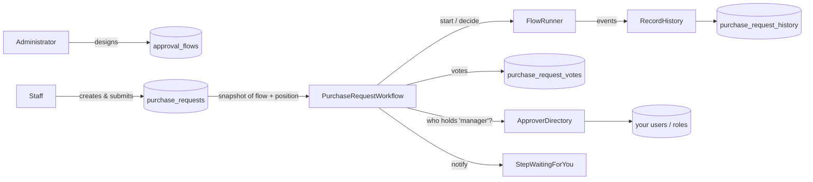
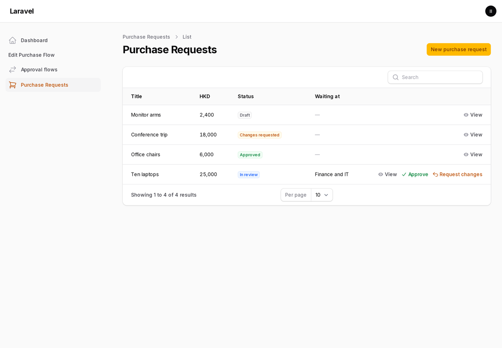
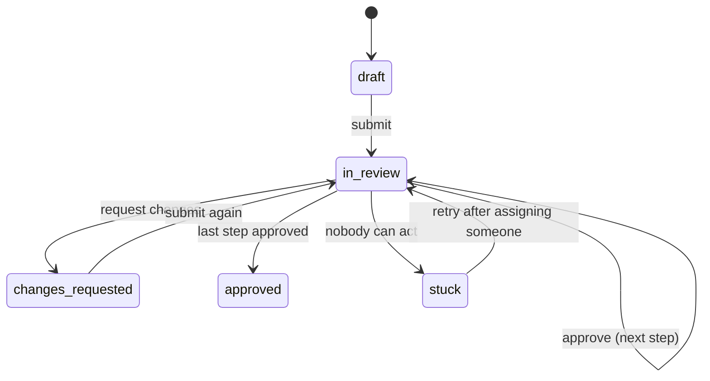
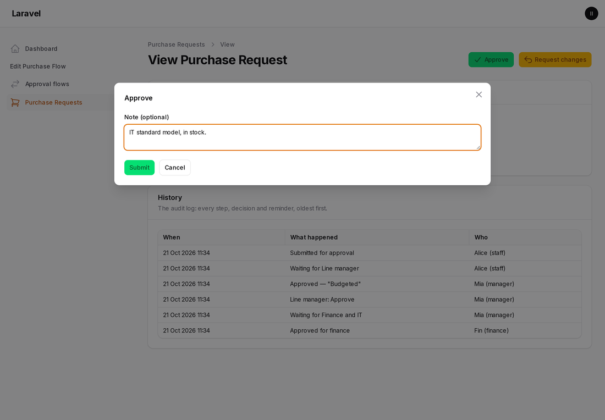
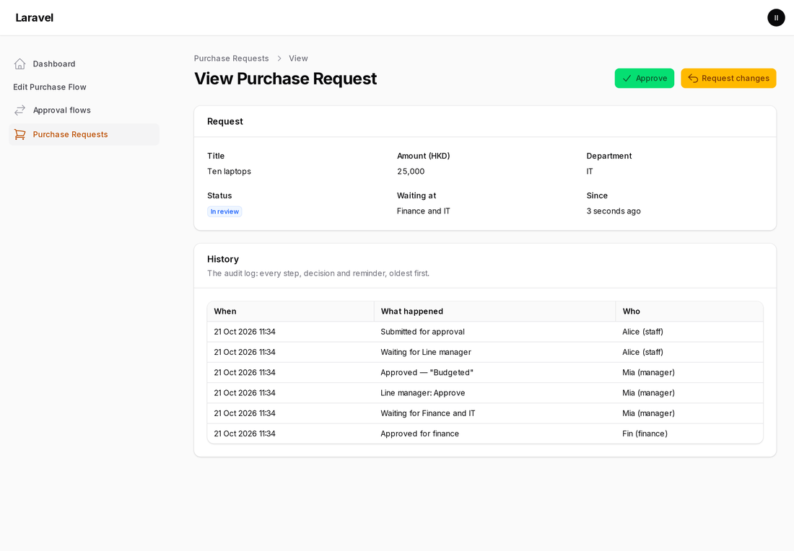
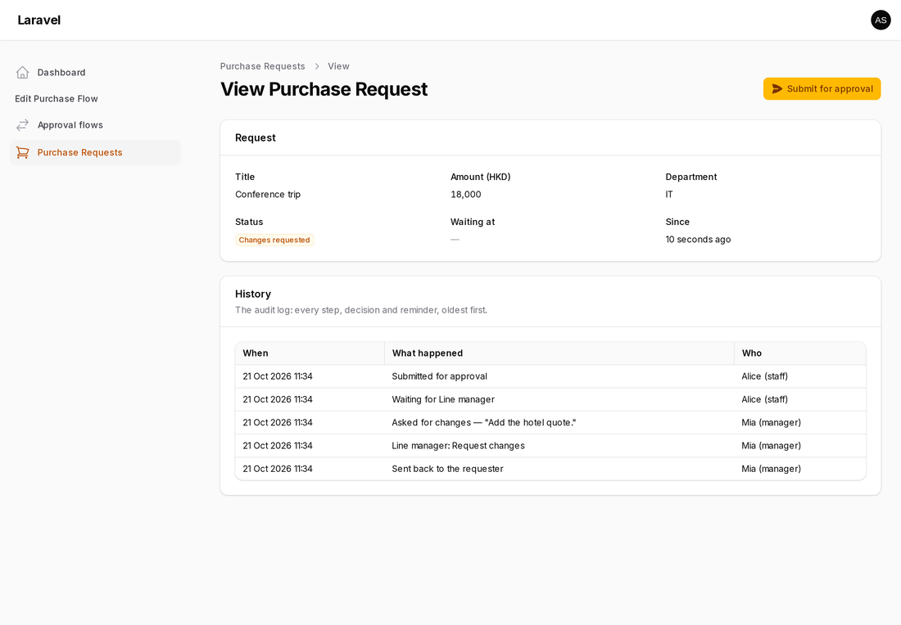

# Using Filament Flow Builder in a real application

The [README](../README.md) shows how to put the builder on a page. This guide covers the rest: running real items through the flows people design.

It walks through a complete, working example that ships with the plugin: **purchase requests**, in [`examples/PurchaseRequests`](../examples/PurchaseRequests). Every behaviour described here is covered by [its tests](../tests/Feature/Examples/PurchaseRequestsTest.php), and you can copy the folder into your app as a starting point.

It answers these questions:

1. [What the plugin does, and what your app does](#1-what-the-plugin-does-and-what-your-app-does)
2. [The example at a glance](#2-the-example-at-a-glance)
3. [Matching approvers to the users of your system](#3-matching-approvers-to-the-users-of-your-system)
4. [Status: from "where it is in the flow" to what users see](#4-status-from-where-it-is-in-the-flow-to-what-users-see)
5. [Actions: how Approve and Request changes work](#5-actions-how-approve-and-request-changes-work)
6. [Control: who may do what](#6-control-who-may-do-what)
7. [When things go wrong in the middle of a flow](#7-when-things-go-wrong-in-the-middle-of-a-flow)
8. [The audit log](#8-the-audit-log)
9. [Notifications and reminders](#9-notifications-and-reminders)
10. [Testing your workflow](#10-testing-your-workflow)
11. [A checklist before you go live](#11-a-checklist-before-you-go-live)

---

## 1. What the plugin does, and what your app does

| The plugin | Your app |
|---|---|
| The visual editor: steps, conditions, settings, validation, "Test it as…" | Where flows are stored (any JSON column) |
| The **definition**: which step types, conditions, approver keys and teams exist | **Who** holds an approver key: your users, roles, departments |
| The **runner**: given a flow, a position and a decision, it returns the next position and fires events | **The item** (purchase request, leave form, article, …) and its **status** |
| | **Votes**: when a step has enough approvals |
| | **The audit log**, **notifications**, **reminders** |

The runner is deliberately small and stateless, so it fits any data model. The example below shows a sensible way to build the app's side in about 300 lines.

## 2. The example at a glance



| File | Role |
|---|---|
| `Workflow/PurchaseFlow.php` | The **definition**: Approval and Parallel review steps, approver keys `manager`, `finance` and `director`, teams `finance`, `it` and `legal`, and the context fields `amount` and `department` |
| `Workflow/ApproverDirectory.php`, `DatabaseApproverDirectory.php` | The bridge to **your users** ([§3](#3-matching-approvers-to-the-users-of-your-system)) |
| `Workflow/PurchaseRequestWorkflow.php` | **Everything people do**: submit, approve, request changes, retry, reminders ([§4](#4-status-from-where-it-is-in-the-flow-to-what-users-see) to [§9](#9-notifications-and-reminders)) |
| `Workflow/RecordHistory.php` | The **audit log**, written from the runner's events ([§8](#8-the-audit-log)) |
| `Models/*` | `ApprovalFlow` (designed flows), `PurchaseRequest`, `RequestVote`, `RequestHistory` |
| `Filament/Resources/*` | "Approval flows" (the builder), and "Purchase requests" with the action buttons and the history |
| `Console/RemindOverdueCommand.php` | `php artisan purchase-requests:remind`, for the scheduler |
| `PurchaseRequestsServiceProvider.php` | Wires it all up |
| `database/migrations/…` | The tables |

**Try it in your app:** map the namespace in `composer.json`:

```json
"autoload": { "psr-4": { "Banyan\\FilamentFlowBuilder\\Examples\\": "vendor/banyancms/filament-flow-builder/examples/" } }
```

(`examples/` is left out of Composer downloads; copy it from the repository.) Then:

1. Add `PurchaseRequestsServiceProvider` to `bootstrap/providers.php`.
2. Add `ApprovalFlowResource` and `PurchaseRequestResource` to your panel's `->resources([...])`.
3. Run `php artisan migrate`.

The screenshots below come from exactly that.



---

## 3. Matching approvers to the users of your system

The people designing a flow pick **keys**, not people: "Line manager", "Finance", "Director". This is deliberate. Staff change, flows should not. Your app answers one question: **who holds this key right now?**

```php
interface ApproverDirectory
{
    /** @return list<int> user ids holding this approver or team key */
    public function userIds(string $key): array;

    /** @return list<string> the keys this user holds */
    public function keysOf(int $userId): array;
}
```

The example stores assignments in a small `approver_assignments` table. In your app, bind whatever you already have:

```php
// Spatie laravel-permission: one role per key.
final class RoleApproverDirectory implements ApproverDirectory
{
    public function userIds(string $key): array
    {
        return User::role($key)->orderBy('id')->pluck('id')->all();
    }

    public function keysOf(int $userId): array
    {
        return User::find($userId)?->getRoleNames()->all() ?? [];
    }
}

// In a service provider:
$this->app->singleton(ApproverDirectory::class, RoleApproverDirectory::class);
```

**Keys can be relative:** "the requester's manager" or "the head of the requester's department". Resolve such keys per request in your workflow (where you know the requester) rather than in a global directory. The definition's `approvers()` only lists the choices the designer sees.

## 4. Status: from "where it is in the flow" to what users see

The runner only knows **positions**: at a step (and which), *returned* to the start, or *finished*. Store the position on your item as JSON, and derive the status your users see from it:

| Position | Example status | Meaning |
|---|---|---|
| (not submitted) | `draft` | The requester is still writing it |
| `step` + step id | `in_review` (plus `current_step`, `step_reached_at`) | Waiting for that step's people |
| `step`, but nobody can act | `stuck` | See [§7](#7-when-things-go-wrong-in-the-middle-of-a-flow) |
| `returned` | `changes_requested` | Back with the requester, who can submit again |
| `finished` | `approved` | Every step is done; do whatever "approved" means in your app |



All of this happens in one method of the workflow, `apply(Position $position)`:

```php
private function apply(PurchaseRequest $request, Position $position): void
{
    $request->position = $position->toArray();

    if ($position->isReturned()) { /* status: changes_requested */ }
    elseif ($position->isFinished()) { /* status: approved */ }
    else { /* status: in_review, or stuck when nobody can act; notify the step's people */ }
}
```

Keep it in one place. Every path (submit, approve, changes, retry) goes through it, so the status can never disagree with the position.

**Snapshot the flow when the item starts.** The example copies the designed flow into the request on submit (`purchase_requests.flow`). An administrator can then change or delete the template at any time without moving requests that are already in it. A test covers this.

## 5. Actions: how Approve and Request changes work

A built-in Approval step has two outcomes, `approve` (next step) and `changes` (back to the start). A Parallel review has the same keys. Your own step types declare their own outcomes, and the runner refuses any outcome a step does not have.

**One click is not always one decision.** The designer chose a rule on the step:

| Step setting | Moves on when… |
|---|---|
| Approval, *any one* | one person holding a key has approved |
| Approval, *all of them* | every person who may act has approved |
| Approval, *a number* (`count`) | that many different people have approved |
| Parallel review | one person from **each** team has approved |
| any step, "Request changes" | immediately, from anyone who may act |

So the app records each person's decision as a **vote**, and only calls the runner when the step's rule is met:

```php
public function approve(PurchaseRequest $request, int $actorId, ?string $note = null): void
{
    // 1. Is it waiting, and may this person act? (§6)
    // 2. Record the vote (with the team, for a parallel review), and log it.
    // 3. Enough approvals for the step's rule? Then:
    $position = $this->runner->decide($definition, $flow, Position::at($step->id), 'approve', $context);
    $this->apply($request, $position);
}
```

Votes belong to one round of one step. When the step is reached again (after changes were asked for), the old votes are cleared, so earlier approvals do not carry over into the new round. A test covers this.

In the panel, the actions are ordinary Filament actions (`Filament/Resources/PurchaseRequests/WorkflowActions.php`). Each one calls the workflow and turns its refusals into a message:



## 6. Control: who may do what

All rules live in the workflow service, never only in the UI:

| Rule | Where |
|---|---|
| Only a draft or a returned request can be submitted | `submit()` |
| A flow with problems cannot be used | `submit()` runs `FlowValidator::problems()` |
| Only the people of the **current** step may act | `canAct()` / `whoCanAct()`: the step's keys, through the directory |
| Nobody approves their own request (two-person rule) | `whoCanAct()` leaves the requester out |
| Nobody approves twice; one approval per team | `alreadyApproved()` |
| "Request changes" needs a reason | `requestChanges()` |

The Filament buttons use the same methods for visibility (`->visible(fn ($record) => $workflow->canAct($record, auth()->id()))`), so people only see what they may do:

| The approver of the current step sees | The requester sees |
|---|---|
|  |  |

Every refusal is a `WorkflowException` with a sentence you can show. The actions catch it and show it as a notification.

## 7. When things go wrong in the middle of a flow

| Situation | What happens in the example | How you see it |
|---|---|---|
| **Someone asks for changes** | The runner returns `returned`, the status becomes `changes_requested`, and the requester can edit and submit again. The new round starts at the first step and earlier votes no longer count. | History: "Asked for changes — '…'", then "Sent back to the requester" |
| **Nobody can act on the step** (a key nobody holds; the only approver left) | Status `stuck`, a `stuck` line in the log. Nobody is silently waited for. Assign someone in the directory, then **Try the step again** (`retry()`). | A red *Stuck: nobody can act* badge; history "Stuck: nobody can act on …" |
| **The template is edited or deleted meanwhile** | No effect: the request runs on its own snapshot. | — |
| **The flow has problems** (a step with no approvers, a condition with no value) | `submit()` refuses: "The approval flow has problems; fix it in the builder first." The builder also refuses to save such a flow. | A message to the requester |
| **A step waits too long** | `remindOverdue()` notifies its people again after the step's "Remind after … days" (once per step). | History "Reminder sent for …" |
| **A decision the step does not offer**, or a stale position | The runner throws `InvalidArgumentException`. The example only calls it with outcomes it knows, from the item's own snapshot, so this means a bug. Let it fail loudly. | Your error tracker |
| **A condition type that no longer exists** | The runner treats the step as applying: it never silently skips a step it cannot judge. | — |
| **A step type that no longer exists** | `decide()` throws (no such outcome). Keep old step types registered while items may still sit at them. | Your error tracker |

**Watching for problems:** a list filtered on `status = stuck`, and a check for `in_review` items whose `step_reached_at` is old, cover most operational needs. Both are plain queries on your own table.

## 8. The audit log

The runner fires an event for every move. The example records each one with a single subscriber, together with the workflow's own entries (submitted, voted, stuck, retried, reminded):

```php
class RecordHistory
{
    public function subscribe(Dispatcher $events): void
    {
        $events->listen(StepReached::class, fn (StepReached $e) => $this->write($e->definition, $e->context, 'step_reached', $e->step->id, $e->step->name));
        $events->listen(StepSkipped::class, fn (StepSkipped $e) => $this->write($e->definition, $e->context, 'step_skipped', $e->step->id, $e->step->name));
        $events->listen(OutcomeChosen::class, fn (OutcomeChosen $e) => $this->write($e->definition, $e->context, 'outcome', $e->step->id, $e->step->name, ['outcome' => $e->outcome->key]));
        $events->listen(FlowReturned::class, fn (FlowReturned $e) => $this->write($e->definition, $e->context, 'returned', $e->from->id, $e->from->name));
        $events->listen(FlowFinished::class, fn (FlowFinished $e) => $this->write($e->definition, $e->context, 'finished'));
    }
}
```

**How the log knows which item and who acted:** the runner knows nothing about either. The workflow passes them in the **context**, next to the values conditions look at:

```php
$context = ['amount' => $request->amount, 'department' => $request->department,
            'purchase_request_id' => $request->id, 'actor_id' => $actorId];
```

The listener also checks `$event->definition === PurchaseFlow::key()`, so other flows in your app keep their own logs.


**Need a stronger log?** Send the same events to your existing audit system instead of a table: Spatie activitylog, an append-only or hash-chained log, or a SIEM. The events and the context carry everything you need.

## 9. Notifications and reminders

- **When a step is reached**, `apply()` notifies everyone who may act (`StepWaitingForYou`, by mail in the example; use any Laravel channel).
- **Reminders:** a step type that is `remindable()` gets "Remind after … days" in the builder, stored as `reminder_days`. The example's `remindOverdue()` sends one reminder per step once it waits longer, and logs it. Schedule the command:

  ```php
  // routes/console.php
  Schedule::command('purchase-requests:remind')->hourly();
  ```

- **When the item finishes** (or is returned), notify the requester from `apply()`, or from a `FlowFinished` / `FlowReturned` listener.

## 10. Testing your workflow

Test the workflow service directly. It is plain PHP over your tables. From the example's tests:

```php
it('takes a request through every step to approved', function (): void {
    [$alice, $mia, $fin, $ivan, $dora] = [prUser('Alice'), prUser('Mia', 'manager'), prUser('Fin', 'finance'), prUser('Ivan', 'it'), prUser('Dora', 'director')];
    $request = prRequest($alice, prFlow());

    $workflow->submit($request, $alice->id);
    $workflow->approve($request->fresh(), $mia->id);
    $workflow->approve($request->fresh(), $fin->id);
    $workflow->approve($request->fresh(), $ivan->id);
    $workflow->approve($request->fresh(), $dora->id);

    expect($request->fresh()->status)->toBe(PurchaseRequest::APPROVED)
        ->and(prLog($request))->toBe(['submitted', 'step_reached:manager', 'voted:manager', /* … */ 'finished']);
});
```

The suite covers all of these:

- the happy path;
- a skipped condition;
- changes requested and resubmitted;
- "all of them";
- stuck, then retried;
- a template edited mid-flight;
- every refusal;
- reminders.

Use `Notification::fake()` and `$this->travel(3)->days()` for notifications and reminders.

## 11. A checklist before you go live

- [ ] Every approver key and team in the definition is held by at least one real user, and you know who fixes it when not (`stuck`).
- [ ] Items snapshot the flow when they start.
- [ ] All rules live in the workflow service; the UI only hides buttons.
- [ ] The requester cannot approve their own item, if your organisation requires that.
- [ ] Every move is logged with who and why. Notes are required for "changes".
- [ ] The reminder command is scheduled.
- [ ] Old step types stay registered while items may still sit at them.
- [ ] You have a view of `stuck` and long-waiting items.
- [ ] Your tests cover your process's own paths, starting from the example's suite.
